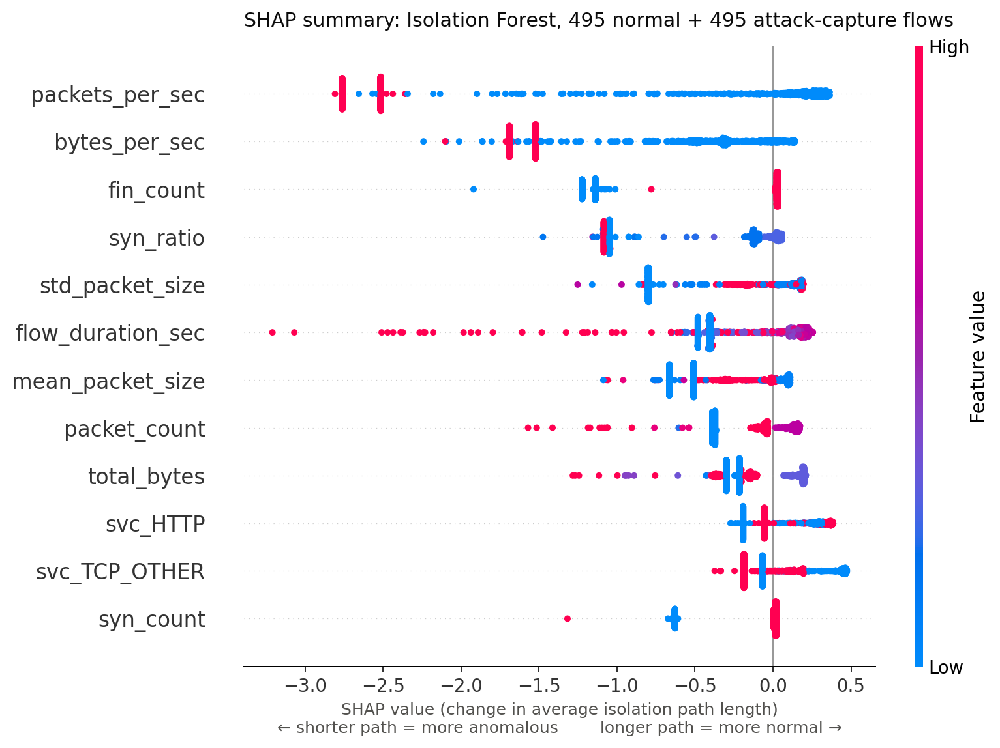
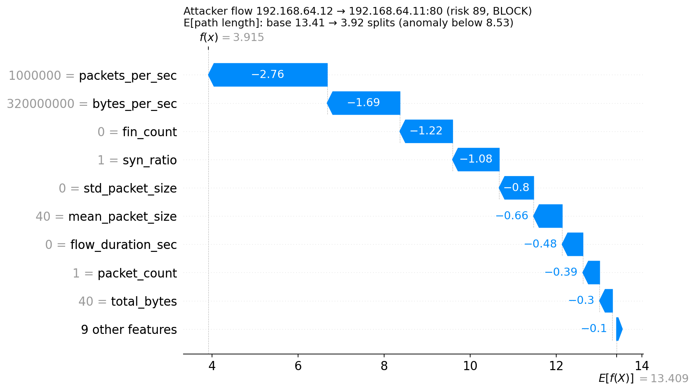
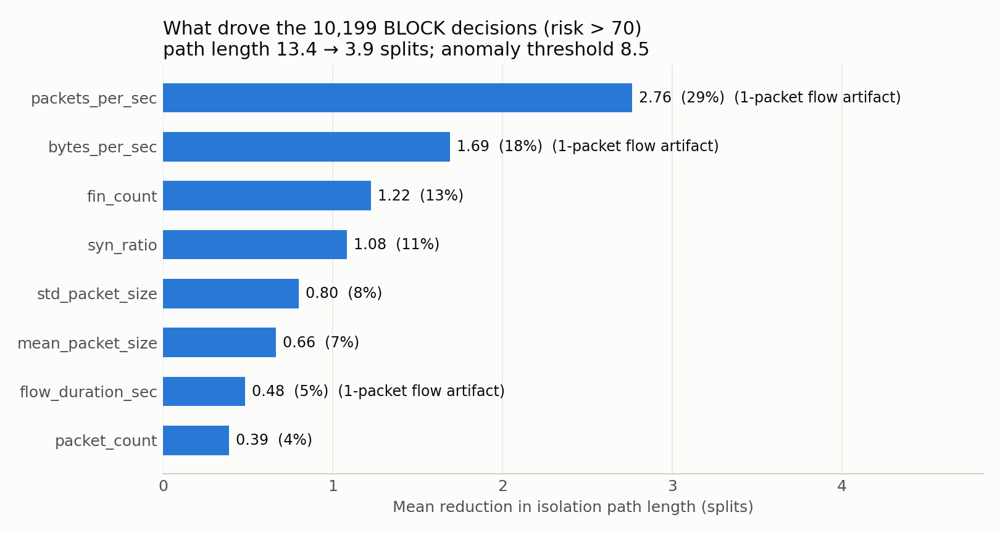

# Adaptive Network Anomaly Detection & Automated Defense

A hybrid network intrusion detection and prevention prototype for a Linux host.
It learns what *normal* traffic looks like, scores every network flow for risk, automatically
rate-limits or blocks suspicious sources with `iptables`, and records every decision in a
SHA-256 hash-chained, tamper-evident audit log. SHAP explains why the ML model flagged each blocked flow.

```
pcap ─► flows (5-tuple) ─► 18 features ─┬─► Isolation Forest (ML)       ─┐
                                        ├─► z-score vs. normal baseline ─┼─► risk score 0–100 ─► LOG / RATE_LIMIT / BLOCK ─► iptables
                                        └─► security rules (CIA + auth) ─┘                     └─► hash-chained audit log (+ SHAP top-3 on BLOCK)
```

## How it works

| Stage | Module | What it does |
|---|---|---|
| Feature extraction | `nad/features.py` | Groups packets into one-directional flows (5-tuple, 120 s idle timeout) and computes 12 numeric features + 6 one-hot protocol/service columns |
| Statistical baseline | `nad/baseline.py` | Mean/std of every feature on normal traffic; flags max z-score > 3 |
| ML detector | `nad/detector.py` | `StandardScaler` + `IsolationForest` (200 trees, contamination 0.05); optional One-Class SVM / ensemble |
| Risk scoring | `nad/risk.py` | ML anomaly +40, z-score up to +30, protocol weight (SSH 1.4, HTTP 1.2, …), rule bonuses; ≤35 LOG, ≤70 RATE_LIMIT, >70 BLOCK |
| Enforcement | `nad/firewall.py` | Dedicated `NAD_DEFENSE` chain; DROP rules for BLOCK, `limit` module (10/s, burst 20) for RATE_LIMIT |
| Audit log | `nad/secure_log.py` | Append-only JSON Lines; `line_hash = SHA256(prev_hash + "|" + canonical JSON)`; `verify_file()` pinpoints edited or deleted lines |
| Orchestration | `nad/pipeline.py` | Training (`train_from_normal_pcaps`) and detection (`score_pcap`) workflows; shared feature builder to avoid training/serving skew |
| Explainability | `nad/explain.py` | SHAP `TreeExplainer` on the Isolation Forest; top-3 features attached to every BLOCK decision |

## Lab setup and results

Three machines on a UTM virtual network (`192.168.64.0/24`): Ubuntu defense VM (`.11`), attacker VM (`.12`), Mac host (`.1`).

1. Captured 60 s of normal traffic (HTTP + SSH): 3,065 packets → **495 flows**; trained the model (18 features).
2. Attacker ran a SYN flood: `hping3 -S -p 80 -i u1000 192.168.64.11`.
3. A 15 s capture of the attack gave **20,399 flows**. The attacker's flows scored **89 → BLOCK**, and a DROP rule was added automatically.
4. Re-running the flood after the block: **22,806 packets sent, 0 received (100% dropped)**, compared with about 1% loss before the block.

Screenshots of each step are in [`OUTPUT-SS/`](OUTPUT-SS); full decisions in `output.csv`; audit trail in `defense_log.json`
(20,411 entries, verifies `ok`).

## SHAP explainability

`TreeExplainer` explains the forest's average isolation path length (base 13.41 splits; anomaly threshold 8.53).
On the 10,199 BLOCK decisions the path dropped to 3.92 splits. Here is what drove that drop:

| Feature | Share of push toward "anomaly" |
|---|---|
| `packets_per_sec` | 29% |
| `bytes_per_sec` | 18% |
| `fin_count` | 13% |
| `syn_ratio` | 11% |

**Finding:** hping3 changes the source port on every packet, so each SYN is a one-packet flow. The code floors a
one-packet flow's duration to 1 µs, so its rate features become 1,000,000 packets/s and 320,000,000 bytes/s.
These rate artifacts (packets/s, bytes/s, duration) account for **52%** of the anomaly signal on blocked flows, while true
SYN-flood behaviour (`syn_ratio = 1`, no FIN) accounts for **24%**. The same explanation appears on the false-positive
block of the admin host, which identifies the root cause of the false positives.

| Summary (495 normal + 495 attack flows) | Attacker flow, risk 89 |
|---|---|
|  |  |



Risk 89 breakdown: ML anomaly (+40) + statistical deviation (+30; `syn_ratio` z = 13.1) = 70 × 1.2 (HTTP) = 84, + 5 (plaintext HTTP) = **89**.

## Usage

```bash
pip install -r requirements.txt            # shap is optional

# 1. train on normal traffic
python3 -m nad.train --normal-pcap normal.pcap --out model.pkl

# 2. detect + enforce (needs root / passwordless sudo for iptables)
sudo venv/bin/python -m nad.run_live --pcap capture.pcap --artifacts model.pkl --log defense_log.json --enforce
#    add --no-shap to skip SHAP explanations

# 3. SHAP plots
python3 scripts/shap_analysis.py --artifacts model.pkl --normal normal.pcap --attack capture.pcap --out shap_out

# 4. verify the audit log
python3 -c "from nad.secure_log import SecureLogger as S; print(S.verify_file('defense_log.json'))"
```

## Known limitations / next steps

- Rate features for one-packet flows are artifacts (see SHAP above); set them to 0 for single-packet flows and retrain.
- Flows are one-directional, so the victim's replies are scored as separate flows. No allowlist, so the admin host was blocked.
- The SYN-flood rule works inside a single flow; it should count SYNs per source IP per time window.
- `iptables -C` is called with a rule position, which makes the existence check fail (rules are still inserted).
- Rules never expire. The log is tamper-*evident*: truncation or a full rewrite is not detected without HMAC or external anchoring.
- Analysis runs on captured pcaps, not live packet streams. Training data is small (60 s).

## Contributions

Team project. **My work:** the SHA-256 hash-chained audit log (`nad/secure_log.py`), the pipeline orchestration
(`nad/pipeline.py`), and the SHAP explainability extension (`nad/explain.py`, `scripts/shap_analysis.py`).
